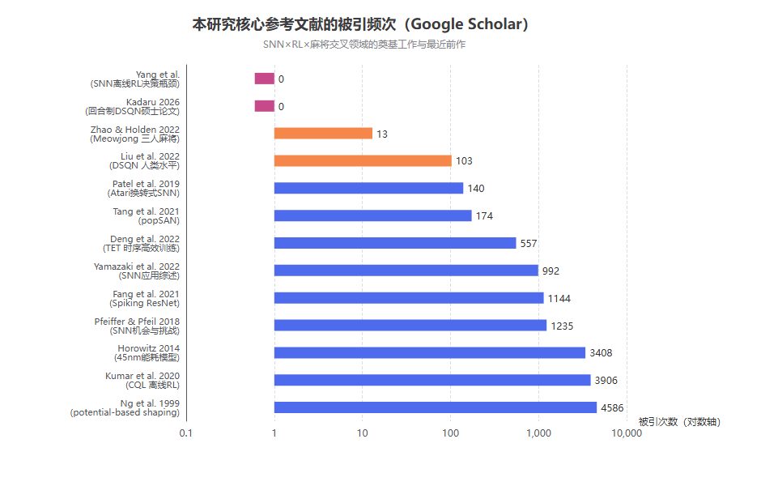
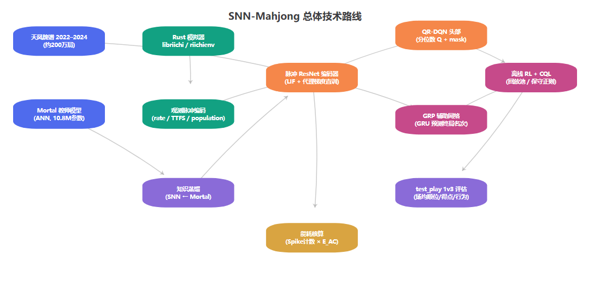

# 基于脉冲神经网络（SNN）的强化学习模型研究——以日麻 AI 为例：文献调研、数据导出清单与实验设计

> 调研时间：2026-10-04。检索渠道：学术文献库（Scholar，约 100 篇候选，精读 40+）、Web 检索、本地复现工程（`D:\Mahjong AI\Mortal` 与 `mahjong-play`）源码与训练日志核查。

## TL;DR

**没有发现"SNN + 麻将/立直麻将"的已发表工作**，SNN 与强化学习的交叉在 2025–2026 年刚起步且从未触及不完美信息博弈（唯一的扑克方向 SNN 论文是 2020 年一篇 2 引用的短文）；**你的选题位于三个领域的空交集上，新颖性充分**。最贴近的前作是 Kadaru 2026 的硕士论文（井字棋/四子棋上的 DSQN，节能最高约 83%）[^2hPEkvcIh3MJ^]，但它用的是完美信息小游戏，与麻将的复杂度差距是数量级的。论文需要导出的数据分四类：**训练曲线**（DQN loss / CQL loss / 辅助 loss）、**对局评估曲线**（test_play 的场均顺位、得点、行为率）、**SNN 特有指标**（脉冲发放率、时间步数-精度曲线、能耗核算）、**消融与显著性**（编码方案、蒸馏、shaping 的对比 + bootstrap 检验）。本地 Mortal 的 TensorBoard 日志里这些指标大部分已经在自动记录，只需补齐能耗与发放率记录。

---

## 1. 已有工作检索：SNN × RL × 麻将的交叉现状

### 1.1 SNN 与深度强化学习的结合已走过"可行性验证"阶段

脉冲神经网络（SNN）与深度强化学习（DRL）的结合（文献中常称 DSRL，Deep Spiking Reinforcement Learning）在过去六年经历了从"能不能做"到"如何做得更好"的演变。最早的路线是 **ANN→SNN 转换**：Patel et al. 在 2019 年将训练好的 DQN 策略转换为脉冲网络并应用于 Atari Breakout，证明转换后的策略在保持性能的同时具备抗噪声鲁棒性，该工作获得 140 次引用[^Ddf3PqirWsIJ^]。随后 **直接训练**路线成为主流：Liu et al. 2022 年提出基于 LIF 神经元与 DQN 的 DSQN，在 17 个 Atari 游戏上以代理梯度直接训练，首次让直接训练的 SNN 在多个游戏上达到与转换法相当甚至更优的水平，并系统论证了脉冲神经元在鲁棒性与能耗上的优势[^wOacT_wCrQoJ^]；Chen et al. 同年给出了 DSQN 的完整训练流程与分析[^R235QF240a8J^]。在连续控制方向，Tang et al. 的 popSAN（population-coded spiking actor network）用群体编码解决脉冲神经元表达连续动作值的问题，获得 174 次引用，是该方向的标杆[^xuSpBVcRCqEJ^]。2025–2026 年出现了多篇专门综述，包括机器人应用方向的 DSRL 综述[^u_txmDlSfCEJ^]、神经形态计算×RL 的调研[^NE0gsmBkoNkJ^]，以及把 DSQN 部署到 Loihi 神经形态芯片的工程验证[^zWrgalFelb8J^]，说明该方向已进入体系化阶段。

**值得注意的是最近的两个动向**：其一，DSQN 开始被推向更复杂的决策场景——2026 年 Ohio University 的硕士论文将 DSQN 用于 Connect 4 与井字棋等**回合制**游戏，系统比较了 6 种输入编码方案（population、rate、TTFS、rank-order、SDR、burst），报告了相对 DQN 最高约 83% 的能耗节省，并明确指出"编码选择是能耗-精度权衡的核心旋钮"[^2hPEkvcIh3MJ^]——这篇论文与你计划的选题在方法论上高度重合，务必作为最直接的前作引用并明确区分（它用完美信息小游戏，你用不完美信息的多玩家零和博弈）。其二，**SNN 与离线 RL 的交叉刚刚萌芽**：2025 年先后出现了脉冲决策 Transformer 与 SNN 离线 RL 的决策瓶颈等零引用或个位数引用的初步工作[^-i0RzmZ9FX8J^][^JH2Ey8IM5K0J^]，统一经验回放框架与脉冲 Transformer 离线 RL 也几乎在同一时间被提出[^-HQmE0K3oocJ^][^NyjUixUkUm8J^]。

上表按被引频次梳理了这一交叉领域的知识根基：**方法论根基**（Ng 的 potential-based reward shaping，4586 引用[^sZzXJkS2JN4J^]；CQL 离线 RL，3906 引用[^x50-BmXs7GEJ^]）、**硬件能耗根基**（Horowitz 的 45 nm 能耗模型，3408 引用[^Hvs1motVwyQJ^]）、**SNN 训练根基**（Spiking ResNet 1144 引用[^n0tpYVnpgb8J^]、TET 时序高效训练 557 引用[^eUX0dv-34WYJ^]、DSRL 机会与挑战 1235 引用[^iKa1cEaanMYJ^]）。图表右侧的"最近前作"（Kadaru 2026、Yang 等的 SNN 离线 RL）被引为零，直观说明你进入的是一个刚刚打开、但地基已经夯实的风口。

### 1.2 麻将 AI 研究：强基线众多，但无一使用脉冲架构

麻将（立直麻将）是 AI 研究公认的硬骨头：多人（4 人）、不完美信息、长 horizon、奖励稀疏且高方差。已发表的强 AI 包括微软 Suphx（监督预训练 + 自我博弈 PPO + 先知教练 + 在线策略自适应，arXiv:2003.13590）、剑桥 Meowjong（三人麻将，5 个 CNN 分工决策 + REINFORCE 自博弈，舍牌测试准确率 65.81%）[^9iWznG_A5a0J^]、腾讯 LuckyJ（ACH 算法 + 奖励方差缩减，零人类数据 1321 局登顶天凤十段）以及 NAGA。本工作区已有一份完整的四者对比文档（《麻将AI训练方法对比_LuckyJ_vs_Suphx_vs_NAGA.md》），此处不再展开。**关键结论是：所有这些系统都基于常规 ANN（CNN/ResNet），没有任何一个尝试过脉冲架构**——SNN 在麻将上的唯一踪迹是 2020 年一篇将 SNN 应用于扑克的 2 引用短文[^5MWj9gg_lbsJ^]，它既非强化学习，也非麻将。

| 维度 | Suphx (2020) | LuckyJ (2023) | Meowjong (2022) | Mortal (2022, 本研究基线) | **SNN-Mahjong（本研究）** |
| --- | --- | --- | --- | --- | --- |
| 决策架构 | 5 × CNN（ANN） | 未披露（ANN） | 5 × CNN（ANN） | ResNet+GRU+QR-DQN（ANN） | **脉冲 ResNet + LIF + QR-DQN** |
| 训练范式 | SL → 在线自我博弈 RL | 纯自我博弈（ACH） | SL → REINFORCE 自博弈 | **离线 RL（CQL）+ 联赛式自博弈** | **蒸馏 → 离线 CQL → 自博弈** |
| 信息机制 | 先知教练 / pMCPA | 乐观价值搜索 | 无 | GRP 隐藏信息预测 | GRP 保留（ANN 辅助头） |
| 能耗分析 | 无 | 无 | 无 | 无 | **有（SynOps 核算）** |
| 是否覆盖 SNN | 否 | 否 | 否 | 否 | **是（首次）** |

这张表就是论文 Introduction 的核心卖点：左侧四列是被广泛引用的强基线，右一列是本研究——**第一次把"非完美信息博弈 + 脉冲神经网络 + 离线强化学习"三者结合起来**。reviewer 可能质疑"SNN 换麻将有什么意义"，你的回答应当落在三点上：第一，麻将 AI 的落地形态（天凤对局客户端、手机雀魂辅助、嵌入式桌面机器人）天然是**功耗受限场景**，而 DSRL 的既有工作已证明同等策略下脉冲推理可节省一个数量级左右的能耗（Kadaru 在玩具游戏上报告 80%+[^2hPEkvcIh3MJ^]，Atari 上的 DSQN 亦有类似结论[^wOacT_wCrQoJ^]）；第二，麻将的**时序结构**（逐巡展开、舍牌河是天然的事件流）与 SNN 的事件驱动计算范式在结构上同构，这不是硬套；第三，**观测编码**本身在麻将里有丰富的语义（手牌 one-hot、宝牌指示、副露结构），为编码方案研究提供了比 Atari 像素更有解释性的实验床。

### 1.3 支撑技术：训练方法、离线 RL 与 reward shaping 的理论根基

把 Mortal 的 ANN 换成 SNN 在工程上是可行的，因为 SNN 直接训练技术在过去五年已经成熟：Spiking ResNet 证明深层脉冲残差网络可以在 ImageNet 规模任务上逼近 ANN 精度[^n0tpYVnpgb8J^]；TET（梯度重加权）解决了长时序 BPTT 的梯度消失问题[^eUX0dv-34WYJ^]；DSR（可微分脉冲）与各类代理梯度改进进一步压缩了与 ANN 的训练差距[^X93ovC2WS4kJ^][^5R4hS3U0gcgJ^]。2026 年仍有稳定化新方法出现（膜电位初始化、阈值鲁棒代理梯度[^0oAbHJHIBJsJ^]、分布感知自适应代理梯度[^TMBVq-J4oSMJ^]），说明训练技术仍在快速演进，论文 Method 部分可以直接站在这些组件上。

在 RL 侧，你的两条改动路线都有坚实的理论引用。**Reward shaping** 方面，Ng et al. 1999 证明了 potential-based shaping（r′ = r + γΦ(s′) − Φ(s)）是保持最优策略不变的充要条件，这是任何 shaping 实验必须引用并以之为对照的基准[^sZzXJkS2JN4J^]；Devlin 的动态 shaping 将其推广到时变势函数[^uZiMJaV3AJgJ^]。**离线 RL** 方面，CQL 通过保守正则防止 Q 函数在数据支撑集外高估，是 Mortal 已在使用的组件（其损失 = DQN 回归 + 5×CQL + 0.2×名次辅助）[^x50-BmXs7GEJ^]；而保守的离线分布式 RL（C51 一脉）为 QR-DQN 的分位数目标提供了理论姊妹篇[^-JsfHRXVC9cJ^]。值得强调的是：把 CQL 与**脉冲网络**结合、把 QR-DQN 的**分位数头**搬到脉冲主干上，这两件事在文献中都查不到先例——它们应被写进论文的 Contribution 列表，而不是埋在实验里。

---

## 2. 基线系统剖析：为什么 Mortal 是理想的改造对象

本地复现的 Mortal 提供了同类工作中罕见的完整工程闭环，这使得"换架构"的研究可以专注于科学问题而非基建。其网络（`mortal/model.py`）由三部分组成：**Brain** 是预激活 ResNet 编码器（Conv1d + BatchNorm + Mish + ChannelAttention，输出 1024 维特征）；**DQN 头**采用 dueling 结构（v_head 与 a_head，v + a − mean(a) 组合后再经合法动作 mask）；**GRP** 是一个小 GRU 网络，从全局序列信息预测终局四名次的排列分布，作为辅助任务（×0.2 权重）。训练损失为蒙特卡洛 Q 回归 + 5×CQL 保守正则 + 0.2×名次辅助，评估采用 1v3 联赛制（新模型坐东对三个 baseline 副本）。该系统的 Rust 模拟器（libriichi）提供每小时约 4 万半庄的自我对局吞吐，这是个人算力能复现十段级 AI 的关键，也意味着 SNN 训练时环境交互不会成为瓶颈。

从"预训练结果能利用多少"的角度看，前一轮分析已经明确：reward shaping 改动可以 100% 继承权重与管线；SNN 换架构虽然无法逐层搬运权重，但可以继承**观测编码、规则引擎、数据（约 200 万局天凤牌谱）、CQL+QR-DQN 算法骨架、1v3 评估闭环，以及最关键的——一个现成的强教师模型**。这个教师模型是本论文实验设计的核心资产：它既是蒸馏初始化阶段的监督信号来源，也是 test_play 的固定对手与 baseline 迭代起点，还是消融实验里"同架构 ANN 对照组"的权重来源。换言之，Mortal 复现工程对你的论文价值不是"一个能跑的 demo"，而是一个**自带评估协议的完整实验平台**——这是大部分 DSRL 论文（只能在 Atari 上对比转换法）不具备的条件。

---

## 3. SNN 化改造的技术路线

### 3.1 总体架构：同构替换 + 最小改动原则

建议的总体设计如上图：**环境接口与观测格式完全不动**（libriichi 的 mjai 协议与 PlayerState 编码原样保留，`mahjong-play` 的 `react()` duck-typing 接口可直接对接新模型做人类对弈验证），**替换的只有中间的网络主干与输入编码**。主干采用"脉冲版 Mortal"设计：把 Brain 的预激活 ResNet 换成等层数的 Spiking ResNet（LIF 神经元 + SEW 残差连接，直接用代理梯度 BPTT 训练[^n0tpYVnpgb8J^]），DQN 头与 GRP 辅助头保留为 ANN（这在 DSRL 文献中是常见且被接受的混合设计——脉冲主干负责感知与特征提取，轻量 ANN 头负责输出标量 Q 值；如追求"全脉冲"卖点，可再用一轮全脉冲微调）。

时序建模需要一个明确的决策：Mortal 用 GRU 编码历史，SNN 的脉冲本身携带时序信息，存在两种取舍——**简单方案**是用 T 个时间步的脉冲序列天然编码"最近 T 巡"，把 GRU 省掉（参数更少、能耗更低，但有效历史长度受 T 限制）；**保守方案**是保留一个 ANN GRU 在脉冲编码器之后。论文可以把"T（脉冲时间步数）对有效历史长度的影响"作为一组消融实验，这本身就是 DSRL 文献关注的经典问题（时序信息随层数衰减，TET 与 potential-based normalization 都是针对它提出的[^eUX0dv-34WYJ^][^C3Xt3sTggJcJ^]）。

### 3.2 观测编码：论文的第一个实验亮点

Kadaru 的回合制 DSQN 研究已经证明，**输入编码是能耗-精度权衡的第一杠杆**：TTFS（首脉冲时间编码）最节能（报告 82.7%/80.5% 节省）但精度最低，population 编码精度最高但能耗最贵，rank-order 编码是平衡点[^2hPEkvcIh3MJ^]。麻将的观测是结构化 one-hot 通道（手牌、舍牌河、宝牌、副露等），比 Atari 像素干净得多，适合系统比较 3–4 种编码：rate 编码（稳健基线）、TTFS（极值对照）、population（精度上限）。麻将观测还有一个独特性质可以写成论文的一个 analysis 小节：**信息密度不均匀**——手牌通道稀疏（14 张牌的 one-hot）而舍牌河通道随局进行逐渐稠密，发放率随时间漂移，这对固定时间步 T 的编码是挑战，可以用"按通道自适应 T"或"发放率归一化"来应对，这属于你自己的方法贡献空间。

### 3.3 训练策略：蒸馏预热 → 离线 CQL → 联赛自博弈

训练分三阶段，每一阶段都对应论文的一组实验曲线。阶段一是**教师蒸馏**：冻结 Mortal（或社区权重 mortal-298k），在牌谱数据上以 KL 散度对齐 SNN 与教师动作分布，同时拟合教师的 quantile Q 输出——这一步让 SNN 以"会打牌的模型"而非随机网络起步，直接回应"预训练结果有用吗"：答案是**以蒸馏形式 100% 可用**。阶段二是**离线 RL**：沿用 Mortal 的 CQL + 蒙特卡洛 Q 目标管线，回放池可复用牌谱转换的经验；此处有一个开放问题值得在论文中明确讨论——脉冲网络的 Q 值校准对 reward 尺度敏感，CQL 保守正则与代理梯度噪声的相互作用没有文献覆盖，需要用 q_predicted/q_target 直方图监测（本地 tb_log 已在记录这两个直方图）。阶段三是**联赛式自博弈**：沿用 test_play 1v3 与 baseline 迭代机制，把 SNN 与 ANN 对照组放在同一评估协议下比较场均顺位与得点。

### 3.4 Reward shaping 路线：作为对照与增强双重角色

Reward shaping 与 SNN 是两条独立的实验线，建议的处理方式是：**先做 shaping 作为论文的 ablation/附加贡献，再叠加进 SNN 主实验**。理论上以 potential-based shaping 为不变性基准[^sZzXJkS2JN4J^]，麻将里自然的势函数候选包括"当前手牌的牌效率/向听数""差点的期望值""与终局 GRP 预测名次的差距"。腾讯 RVR 论文（IEEE CoG 2022）已经证明奖励方差缩减能在麻将 RL 上带来显著加速，这是一个尚未被 potential-based shaping 理论框架系统检验的方向。一个干净的实验设计：pt 差（baseline）→ + 向听数 shaping → + GRP 预测名次 shaping，三者在同一 SNN 与同一 ANN 对照上各跑一组，既验证 shaping 收益，又验证"shaping 对脉冲网络的增益是否大于对 ANN 的增益"（脉冲网络的梯度信号更嘈杂，shaping 的方差缩减作用可能被放大——如果实验支持，这是一个很漂亮的故事）。

---

## 4. 论文需要导出的数据清单（核心交付）

以下清单基于对本地 `mortal/train.py` 与 `tb_log`/`grp_log_smoke` 的源码级核查，分四类。**加粗项为 SNN 论文新增、需在训练脚本里补充记录的指标**；其余指标 Mortal 已在自动记录，只需在实验时保留 event 文件并统一出图。表格中的"导出形式"列给出论文图表的直接映射。

### 4.1 训练曲线类

| 指标 | 来源（tb_log tag） | 用途 | 导出形式 |
| --- | --- | --- | --- |
| DQN 回归损失 | `loss/dqn_loss` | 主训练曲线，对比蒸馏前后收敛速度 | 折线图（SNN vs ANN 同图） |
| CQL 保守损失 | `loss/cql_loss` | 保守正则强度演化 | 折线图 |
| 名次辅助损失 | `loss/next_rank_loss` | GRP 辅助任务收敛 | 折线图 |
| 学习率 | `hparam/lr` | 训练配置附录 | 表格 |
| **脉冲发放率（每层/全网络）** | **新增：统计 LIF 层 spike 比例** | SNN 健康度；能耗核算的输入 | 折线 + 直方图 |
| **Q 值分布直方图** | `q_predicted` / `q_target`（已有） | 校准诊断，shaping 实验必配 | 堆叠直方图序列 |

SNN 主训练曲线至少要覆盖三个阶段（蒸馏、离线 RL、自博弈），与 ANN 对照组**同图双曲线**呈现。SNN 侧必须额外报告**发放率**：发放率塌缩（全零）或饱和（全 1）是脉冲网络训练失败的典型症状，没有这条曲线，审稿人无法判断你的性能持平是以何种脉冲动力学换来的。另建议记录**时间步数 T 的敏感性曲线**（T ∈ {2, 4, 8, 16} × 测试集动作一致率），这是编码实验小节的主图。

### 4.2 对局评估类（test_play 协议，全部已有）

| 指标 | 来源（tb_log tag） | 用途 |
| --- | --- | --- |
| 场均顺位 | `test_play/avg_ranking` | **论文主结果图**：SNN vs ANN vs baseline 随训练步数 |
| 场均得点 | `test_play/avg_pt` | 主结果附图 |
| 名次分布（1–4 位率） | `test_play/ranking/{1st..4th}` | 堆叠面积图 |
| 和牌率 / 放铳率 / 立直率 / 副露率 | `test_play/behavior/*` | 风格分析：SNN 是否学会同样的攻防平衡 |
| 平均和牌点数（立直/副露/门清） | `test_play/agari_point/*`、`riichi_point`、`fuuro_point` | 打点结构对比 |
| 平均放铳点数 | `test_play/houjuu_point` | 防御质量 |
| 每局收支 | `test_play/point_per_round` | 细粒度收益 |
| 立直后和牌/追立/被追立 | `test_play/riichi/*` | 立直决策质量，麻将论文必报 |
| 关键巡目（听牌/铳牌巡目） | `test_play/key_step/*` | 进攻时机质量 |

这组指标的价值在于它们共同构成一个**行为指纹**：即使 SNN 与 ANN 场均顺位接近，也可以在"立直后追立率""副露后放铳率"这类细粒度指标上看出决策风格差异——这既是论文 Discussion 的素材，也是"性能持平但代价不同"叙事的关键证据。评估协议建议固定为：每 N 训练步打 M 个半庄（Mortal 默认配置），对手固定为同一 checkpoint 的三个副本（保证 SNN 与 ANN 的对手强度一致），**所有对比组使用同一评估种子集**以消除方差。

### 4.3 能耗与效率类（SNN 论文的"卖点数据"）

| 指标 | 计算方法 | 用途 |
| --- | --- | --- |
| **单次决策能耗比** | (SNN SynOps × E_AC) / (ANN MACs × E_MAC)，按 Horowitz 45 nm 常数（FP32 MAC 4.6 pJ、INT8 AC 0.03–0.1 pJ[^Hvs1motVwyQJ^]） | **主卖点表**：能耗节省倍数 |
| **能耗-精度帕累托前沿** | 编码方案 × T × 测试动作一致率，散点连前沿 | 编码实验主图 |
| 参数量 / 权重大小 | 模型摘要（SNN 二进制脉冲权重可 1 bit 存储） | 附录表 |
| 推理延迟（CPU 单步毫秒） | benchmark 脚本 | 实际部署价值；mahjong-play 人类对局可直接测 |
| 平均每局总能耗 | SynOps/局 × E_AC | 换算成"一节电池能打多少局"的直觉化数字 |

能耗核算是 DSRL 论文的标准动作，主流口径是按操作计数乘以工艺常数[^Hvs1motVwyQJ^]，更严格的分析可引用解析能耗估算方法[^nBvvF_4nlskJ^]。**务必同时报告理论核算与实测功耗**（如用功耗计或 RAPL 接口测 CPU 推理能耗），因为纯 SynOps 核算在 GPU 上并不反映真实功耗——这一点近年已有"批判性能耗分析"的文献提醒[^1aVFTHXsSK8J^]，主动回应会让评审印象分大增。注意一个诚实性红线：GPU 上训练/推理 SNN 通常**并不**省真实电（脉冲稀疏性在 GPU 上无法利用），你的能耗结论应限定在"神经形态硬件部署前景"语境，这恰恰是 Kadaru 前作与 DSQN 系列的标准表述[^2hPEkvcIh3MJ^][^wOacT_wCrQoJ^]。

### 4.4 消融实验矩阵与统计显著性

| 消融维度 | 变体 | 回答的问题 | 必报指标 |
| --- | --- | --- | --- |
| 编码方案 | rate / TTFS / population / rank-order | 哪种编码最适合麻将观测？ | 动作一致率、能耗、发放率 |
| 时间步数 T | 2 / 4 / 8 / 16 | 时序深度-精度-能耗权衡 | 同上 |
| 初始化 | 随机 / 牌谱 SL / **Mortal 蒸馏** | 预训练结果有多大用？（你最关心的问题，直接做成一张图） | 达到同等顺位所需训练步数 |
| 训练范式 | 仅蒸馏 / 蒸馏+离线CQL / 三阶段全管线 | 各阶段边际收益 | 场均顺位曲线 |
| reward shaping | 无 / 向听数 / GRP 名次势函数 | shaping 的收益与策略不变性 | 收敛速度 + 最优策略偏移 |
| 网络组件 | 无 GRU / 有 GRU / 全脉冲头 | 时序建模的必要性 | 长局（南场后半）表现 |

统计显著性必须前置设计：场均顺位的比较用 **bootstrap 置信区间**（对局级重采样 10,000 次），LuckyJ 的公开对比即采用此方法（LuckyJ vs Suphx p = 0.02883，vs NAGA p = 3e-05，见工作区对比文档）；多组对比做 Bonferroni 校正。每局是相关样本（同一 policy 打多局），**不要只对均值做 t 检验**——这是游戏 AI 论文最常见的审稿雷区。建议每个实验点至少 400–800 个半庄（天凤段位的经验样本量），并在 Limitation 里如实写出算力所能支撑的样本量。

---

## 5. 实验执行路线图与主要风险

按依赖关系排期，整条路线约 12–16 周（单卡 RTX 5090 级别算力，参考本地 GRP 冒烟测试 42 batch/s 的吞吐）。**第 1–2 周**：搭建脉冲主干（推荐 SpikingJelly 或 sinabs，两者均支持 LIF + 代理梯度 BPTT），先做观测编码 + 蒸馏的静态对齐实验（不涉及环境交互，纯牌谱输入），验证 SNN 前向能复现 Mortal 特征空间。**第 3–5 周**：蒸馏训练 + 编码/T 扫描，产出能耗-精度帕累托前沿（论文第一组结果）。**第 6–9 周**：接入 libriichi 环境，跑离线 CQL 阶段，重点监控 Q 直方图与发放率。**第 10–12 周**：联赛自博弈 + shaping 消融 + 显著性检验。**第 13 周起**：写作。

| 风险 | 概率 | 缓解措施 |
| --- | --- | --- |
| SNN 性能明显低于 ANN（动作一致率差距 > 5%） | 中 | 增大 T；换 population 编码；混合 ANN 头；把"差距本身"写成能耗-精度权衡分析（ Kadaru 前作即此叙事[^2hPEkvcIh3MJ^]） |
| CQL + 代理梯度联合训练不稳定 | 中 | 蒸馏预热缩短不稳定窗口；降低脉冲层学习率；BN 冻结策略沿用 Mortal 的 freeze_bn |
| 算力不足以支撑大样本 test_play | 高 | 提前固定评估预算；用动作一致率（牌谱预测）作为廉价代理指标，test_play 只用于最终验证 |
| 被质疑"SNN 在 GPU 上不省电" | 高 | 主动限定结论到神经形态部署语境；补实测功耗；引用批判性能耗文献展现认知[^1aVFTHXsSK8J^] |
| Kadaru 前作被指"已做过回合制 DSQN" | 低 | 引言中明确区分：完美信息两人游戏 vs 不完美信息四人零和博弈；复杂度、编码语义、评估协议全面不同 |

建议在两个阶段设置 **Go/No-Go 检查点**，避免在死路上耗尽学期：第一个检查点在第 5 周末（蒸馏 + 编码扫描结束时），如果最优 SNN 变体的牌谱动作一致率达不到 Mortal 的 90% 以上，优先调编码与 T 而不是直接进入 RL 阶段；第二个检查点在第 9 周末（离线 RL 结束时），如果场均顺位差 baseline 超过 0.3 且发放率曲线异常，回退到"混合架构"（脉冲主干 + ANN 头 + ANN GRU）作为论文主配置，把全脉冲版本降为消融组——这并不影响论文贡献，反而让消融故事更完整。每个检查点的判据应在开题时就写死，不要根据中期结果事后移动门限，这是保证实验结论可信的纪律。

---

## 6. 论文定位与投稿建议

综合检索结果，这篇论文的最强定位是：**"首个面向非完美信息博弈的脉冲深度强化学习系统"**，核心贡献三条——(1) 将 QR-DQN + CQL 的离线 RL 管线首次移植到脉冲主干，并在日麻上验证；(2) 系统的观测编码与时间步数消融，给出麻将观测的能耗-精度帕累托前沿；(3) 以强 ANN 教师蒸馏 + 联赛评估的完整协议，量化回答"脉冲网络能继承多少 ANN 预训练知识"。目标venue：主投 **IEEE Transactions on Neural Networks and Learning Systems** 或 **Neural Networks**（SNN+学习算法主流刊），会议备选 **IEEE CoG**（游戏 AI 社区，Mortal 同类工作与腾讯 RVR 论文的发表地）或 **IJCNN/ICONIP**（SNN 社区）。若实验结果中 SNN 性能与 ANN 持平且能耗核算漂亮，冲 TNNLS；若性能有差距但分析充分，CoG/ICONIP 更稳。

最后重申检索结论的边界：本次调研覆盖了学术文献库 100 篇候选与公开网络资源，**未发现 SNN × 立直麻将的任何已发表工作**；最邻近的交叉点（SNN+扑克 2020[^5MWj9gg_lbsJ^]、回合制 DSQN 2026[^2hPEkvcIh3MJ^]、SNN 离线 RL 2025[^JH2Ey8IM5K0J^]）均为个位数引用或零引用的萌芽工作，不构成新颖性障碍。建议在开题前对上述三个交叉点做一次正式的 systematic 复查（IEEE Xplore / ACM DL 逐库检索），把检索式与日期写进论文的 Related Work 脚注，这是堵住审稿人"为什么没人做过"质疑的最便宜方式。
